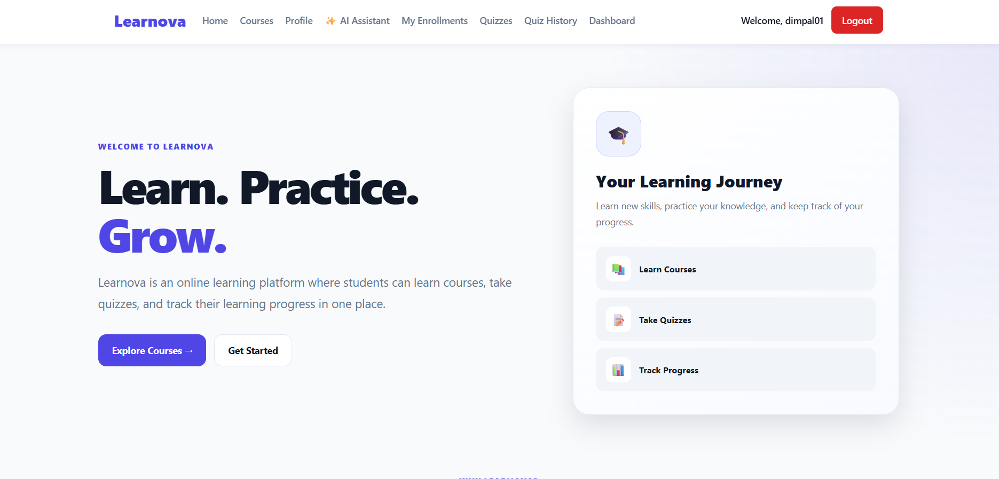
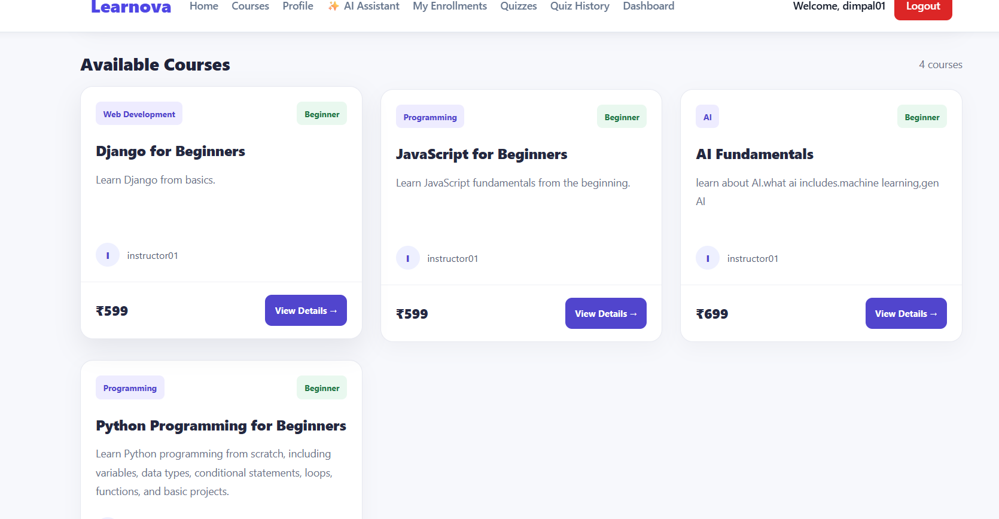
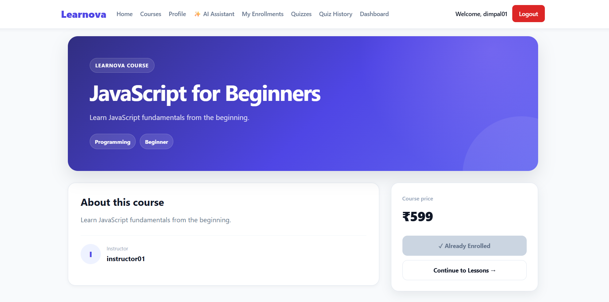
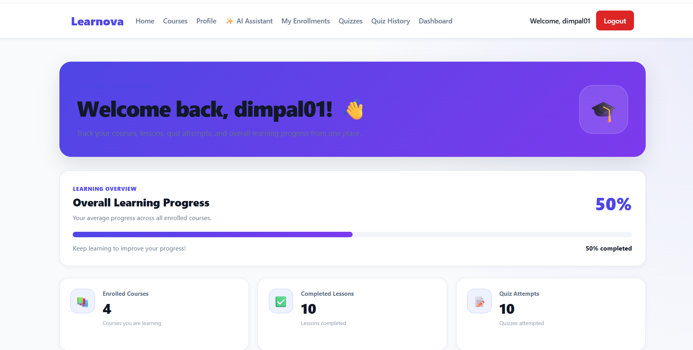
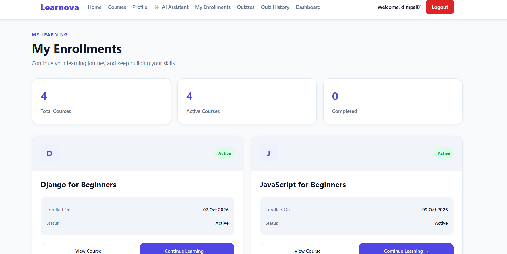
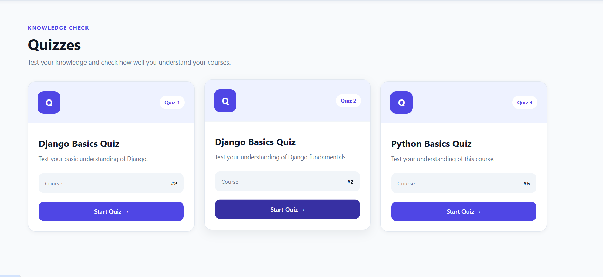
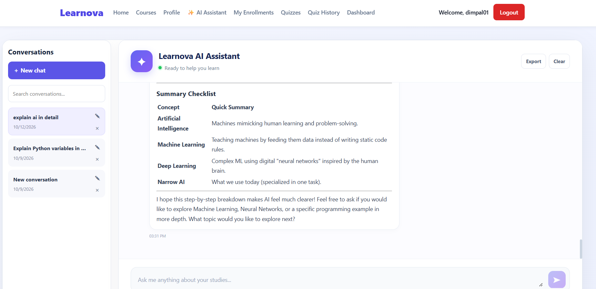
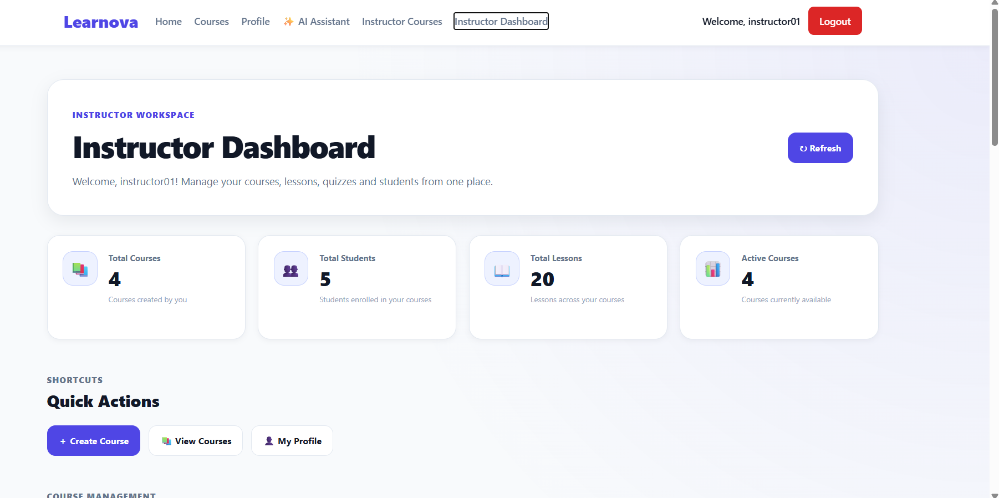

# Learnova — Online Learning Platform

Learnova is a web-based learning platform built with Django REST Framework and React. It brings course management, student enrollment, lessons, quizzes, learning progress, and AI-assisted learning together in one application.

The project uses PostgreSQL for data storage and JWT authentication for protected API endpoints.

## Screenshots

### Home Page



### Courses



### Course Details



### Student Dashboard



### My Enrollments



### Quizzes



### AI Chatbot



### Instructor Dashboard



## Features

### Student

- Register and log in to the platform.
- Browse available courses and view course details.
- Enroll in courses.
- Access lessons associated with enrolled courses.
- Attempt quizzes and review quiz attempts.
- Track lesson completion and learning progress.
- Use the AI chatbot for learning assistance.

### Instructor

- Create and manage courses.
- Add and manage course lessons.
- Create quizzes and manage quiz questions.
- Organize learning content for students.

## Technology Stack

| Area | Technologies |
|---|---|
| Frontend | React, Vite, JavaScript, HTML, CSS |
| Backend | Python, Django, Django REST Framework |
| Database | PostgreSQL |
| Authentication | JWT, Django REST Framework Simple JWT |
| API Requests | Axios |
| AI Integration | Google Gemini API |

## Project Structure

```text
Learnova/
├── backend/
│   ├── accounts/
│   ├── chat_history/
│   ├── chatbot/
│   ├── courses/
│   ├── enrollments/
│   ├── quizzes/
│   ├── config/
│   ├── manage.py
│   └── requirements.txt
├── frontend/
│   ├── public/
│   ├── src/
│   │   ├── components/
│   │   ├── context/
│   │   ├── pages/
│   │   ├── services/
│   │   └── styles/
│   ├── package.json
│   └── vite.config.js
├── docs/
│   └── screenshots/
├── .gitignore
└── README.md
```

## Getting Started

### Prerequisites

Make sure the following are installed:

- Python
- Node.js and npm
- PostgreSQL

### 1. Clone the repository

```bash
git clone YOUR_GITHUB_REPOSITORY_URL
cd Learnova
```

Replace `YOUR_GITHUB_REPOSITORY_URL` with the URL of your GitHub repository.

### 2. Configure environment variables

Create a `.env` file in the project root, using the environment variable names expected by `backend/config/settings.py`.

Add your own local configuration for the Django secret key, database connection, debug setting, and Gemini API key.

Do not commit your `.env` file or expose real credentials.

### 3. Set up the backend

Create and activate a Python virtual environment if you don't already have one.

From the project root, install the backend dependencies:

```bash
pip install -r backend/requirements.txt
```

Create the PostgreSQL database specified in your environment configuration.

Apply database migrations:

```bash
python backend/manage.py migrate
```

Start the Django development server:

```bash
python backend/manage.py runserver
```

The backend normally runs at `http://127.0.0.1:8000/`.

### 4. Set up the frontend

Open another terminal from the project root:

```bash
cd frontend
npm install
npm run dev
```

Open the local URL printed by Vite in your terminal.

## API

The backend exposes REST API endpoints for authentication, courses, enrollments, lessons, quizzes, and learning progress.

Protected endpoints use JWT authentication. The frontend communicates with the backend through Axios.

## Security Notes

- Keep secret keys and API credentials in environment variables.
- Do not commit `.env` files, access tokens, or local virtual environments.
- Use appropriate production settings before deploying the application.

## Future Improvements

- Deploy the application to a production environment.
- Expand learning analytics and progress reporting.
- Improve the AI-assisted learning experience.